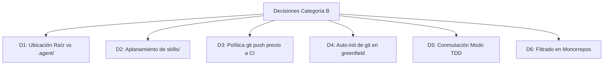

# Plan Técnico de Arquitectura y Gobernanza: 001-qa-hardening

- **Spec Vinculada**: `specs/001-qa-hardening/spec.md`
- **Autor / Rol**: `@planner` (System Architect Planner)
- **Fecha**: 2026-11-23
- **Estado**: implementado

---

## 1. Visión General, Contexto y Objetivos de Hardening

### 1.1 Contexto
Tras la auditoría integral de QA realizada sobre la arquitectura, convenciones, flujos de trabajo y agentes de `agent-core`, se identificaron **25 hallazgos críticos** divididos en:
- **8 Casos no cubiertos** (escenarios límite, fallos de infraestructura local y concurrencia).
- **6 Ambigüedades** (conceptos y métricas sin delimitación operativa precisa).
- **5 Contradicciones** (incompatibilidades directas entre workflows, roles y reglas de gobernanza).
- **6 Conflictos** (fricciones entre restricciones de plataforma, APIs nativas y sistemas operativos).

### 1.2 Objetivo del Plan
Establecer una arquitectura coherente, determinista y robusta para `agent-core`, eliminando cualquier contradicción interna en los permisos de los subagentes, garantizando compatibilidad nativa con **Google Antigravity**, **OpenCode**, **Claude Code** y **Codex**, y preparando el arnés para su adopción sin fricciones en sistemas Windows y Unix.

---

## 2. Clasificación y Resolución de los 25 Hallazgos de QA

Los hallazgos se estructuran en dos categorías operativas:
- **Categoría A (19 hallazgos)**: Correcciones inmediatas, obvias y deterministas que restauran la consistencia lógica interna sin alterar la experiencia deseada por el usuario.
- **Categoría B (6 hallazgos / decisiones)**: Puntos de diseño arquitectónico y gobernanza que requieren validación explícita mediante confirmación humana.

```
┌────────────────────────────────────────────────────────────────────────┐
│                   CLASIFICACIÓN GENERAL DE HALLAZGOS                   │
├───────────────────────────────────┬────────────────────────────────────┤
│   CATEGORÍA A: INMEDIATAS (19)    │     CATEGORÍA B: DECISIONES (6)    │
│ • Permisos de Implementer/spec.md │ • Ubicación Raíz vs .agent/        │
│ • Asignación Comandos Git         │ • Aplanamiento de skills           │
│ • Granularidad de update_steps    │ • Política de git push previo a CI │
│ • Prompt de rol subagente self    │ • Auto-inicialización de git init  │
│ • defaultAgent en opencode.json   │ • Conmutación Supervisado/Autónomo │
│ • Bloqueo index.lock en Windows   │ • Soporte Monorrepos sin filtro    │
│ • + 13 casos de robustecimiento   │                                    │
└───────────────────────────────────┴────────────────────────────────────┘
```

---

### 2.1 Categoría A: Correcciones Inmediatas y Obvias

#### A.1 Contradicción de permisos de `implementer` frente a `spec.md` (Hallazgo 17)
- **Problema**: La Fase 5 de `workflows/sdd-implement.md` instruye: *"Si es la primera tarea, asegura que spec.md tenga Estado: en_progreso"*. Sin embargo, `agents/implementer.md` establece taxativamente: `action: edit, resource: "specs/**/spec.md", effect: deny`.
- **Causa Raíz**: Asignación indebida de una responsabilidad de gestión de ciclo de vida a un agente técnico acotado a código y pruebas.
- **Solución Técnica**: 
  1. Transferir la transición de estado a la Fase 4 de `workflows/sdd-tasks.md`: `@planner` establece el estado `en_progreso` al generar o validar `tasks.md`.
  2. En `workflows/sdd-implement.md`, `@implementer` únicamente lee `spec.md` para validar requerimientos funcionales y solo actualiza casillas de verificación `- [x]` en `tasks.md`.
- **Archivos Afectados**: `workflows/sdd-implement.md`, `workflows/sdd-tasks.md`.

#### A.2 Asignación de Comandos Git a Roles con `shell: deny` (Hallazgo 16)
- **Problema**: `workflows/review-and-pr.md` y `workflows/sdd-status.md` instruyen ejecutar comandos Git (`git fetch`, `git rebase`, `git branch -m`, `git commit`, `git checkout`, `git reset`, `git push`), mientras que `@coordinator` y `@planner` tienen formalmente `shell: deny`.
- **Causa Raíz**: Omisión de la delegación de comandos de sistema operativo al único rol autorizado a invocar la consola (`@implementer`).
- **Solución Técnica**:
  1. Todo comando Git de inspección, rebase, checkout o commit se delega explícitamente a `@implementer`.
  2. `@coordinator` y `@planner` solicitan la ejecución de operaciones Git mediante el despacho de `@implementer`, o bien el coordinador formula las preguntas de confirmación al usuario y despacha a `@implementer` para materializarlas en el árbol de trabajo.
- **Archivos Afectados**: `workflows/review-and-pr.md`, `workflows/sdd-status.md`, `agents/coordinator.md`.

#### A.3 Ajuste de Granularidad de `update_steps` al Flujo SDD (Hallazgo 20)
- **Problema**: La herramienta nativa `update_steps` de Antigravity tiene un límite rígido de 12 elementos. Un flujo que mapee fases más 10 tareas atómicas (16+ transiciones) falla por validación de esquema en la API de Antigravity.
- **Causa Raíz**: Confundir el seguimiento de fases del ciclo de vida agéntico con el desglose de tareas técnicas atómicas.
- **Solución Técnica**:
  1. `update_steps` reflejará exclusivamente las **Fases Canónicas del Flujo SDD** (máximo 7 u 8 pasos):
     - `1. Entrevista de Requerimientos (/sdd-spec)`
     - `2. Clarificación QA (/sdd-clarify)`
     - `3. Plan Técnico (/sdd-plan)`
     - `4. Desglose de Tareas (/sdd-tasks)`
     - `5. Implementación TDD (/sdd-implement)`
     - `6. Validación Integral (/sdd-validate)`
     - `7. Revisión y Pull Request (/review-and-pr)`
  2. El avance de las tareas atómicas individuales (`T1`..`T10`) se comunicará en vivo mediante:
     - `update_focus`: Breve descripción en tiempo real (ej. *"Ejecutando T3: Test unitario de validación de contraseñas"*).
     - El archivo `specs/NNN-nombre/tasks.md`: Marcado quirúrgico de casillas `- [x]`.
- **Archivos Afectados**: `AGENTS.md`, `agents/coordinator.md`, `workflows/sdd-implement.md`.

#### A.4 Neutralización del Veto de Auto-Edición en Subagentes `TypeName: "self"` (Hallazgo 21)
- **Problema**: Al invocar `invoke_subagent` con `TypeName: "self"`, la subsesión hereda las reglas globales de `AGENTS.md`. Si el prompt no anula explícitamente el veto de auto-edición, el subagente asume que tiene prohibido invocar `edit_file`, `write_file` y `run_command`.
- **Causa Raíz**: Falta de especialización contractual en el prompt de despacho de subagentes en plataformas que no tienen namespaces de herramientas independientes.
- **Solución Técnica**:
  Estandarizar una directiva de anulación obligatoria en el prompt de despacho de todo subagente:
  ```markdown
  Actúas en el rol de @implementer [o @planner / @reviewer].
  DIRECTIVA DE AUTORIDAD Y PERMISOS:
  Dentro del alcance de tu rol, tus capacidades de creación/edición de archivos y ejecución de comandos de consola están plenamente activas y autorizadas.
  El veto de auto-edición y consola aplica estricta y exclusivamente al hilo principal del @coordinator.
  ```
- **Archivos Afectados**: `AGENTS.md`, `agents/coordinator.md`.

#### A.5 Declaración de Agente Predeterminado en `opencode.json` (Hallazgo 25)
- **Problema**: `templates/adapters/opencode.json.template` define las carpetas de agentes y comandos, pero no declara qué agente debe asumir la sesión inicial o predeterminada, permitiendo que OpenCode instancie un perfil no coordinador.
- **Causa Raíz**: Omisión de la clave de configuración de entrada de OpenCode.
- **Solución Técnica**:
  Incorporar en `templates/adapters/opencode.json.template`:
  ```json
  {
    "defaultAgent": "coordinator",
    "primary": "coordinator"
  }
  ```
- **Archivos Afectados**: `templates/adapters/opencode.json.template`.

#### A.6 Prevención de Bloqueos Concurrentes en `.git/index.lock` en Windows (Hallazgo 24)
- **Problema**: Al operar con `Workspace: "inherit"`, la ejecución simultánea de comandos de lectura de Git por el coordinador y comandos de staging/commit por el implementador genera excepciones `EBUSY / index.lock` en el sistema de archivos de Windows.
- **Causa Raíz**: Falta de serialización y aislamiento de llamadas Git entre hilos en repositorios compartidos.
- **Solución Técnica**:
  1. Establecer una regla de exclusión mutua: `@coordinator` no invoca ningún comando de Git mientras un subagente `@implementer` esté activo.
  2. Todo el ciclo Git (status, add, commit) se ejecuta de forma sincrónica y exclusiva dentro del turno de `@implementer`.
  3. Añadir en `.gitignore` y scripts de verificación la comprobación de locks huérfanos generados por terminaciones anómalas.
- **Archivos Afectados**: `AGENTS.md`, `agents/coordinator.md`, `agents/implementer.md`.

#### A.7 Naturaleza Dual de los Bloques de Permisos YAML (Hallazgo 23)
- **Problema**: Las directivas `permissions: [action, resource, effect]` de `agents/*.md` solo son interceptadas a nivel de software por OpenCode; en Antigravity, Claude Code y Codex son texto inerte sin intercepción de API.
- **Causa Raíz**: Diferencia de capacidades de enforcement entre agentes con interceptores nativos de herramientas y agentes fundamentados en instrucciones de contexto.
- **Solución Técnica**:
  1. Documentar explícitamente en `agents/*.md` y `README.md` el doble nivel de control:
     - **En OpenCode**: Enforcement activo en tiempo de ejecución por el motor de herramientas.
     - **En Antigravity / Claude Code / Codex**: Guardarraíles de comportamiento gobernados por el prompt del sistema y las directivas de `AGENTS.md`.
  2. Asegurar que las restricciones expresadas en YAML tengan su contraparte redactada en prosa imperativa en el cuerpo del archivo Markdown.
- **Archivos Afectados**: `agents/coordinator.md`, `agents/implementer.md`, `agents/planner.md`, `agents/reviewer.md`, `README.md`.

#### A.8 Desacoplamiento del Veto del Coordinador en `/init` (Hallazgo 18)
- **Problema**: La línea 7 de `workflows/init.md` dictamina: *"Es ejecutado directamente por el agente principal / root (no por subagentes aislados)"*, entrando en conflicto con el veto absoluto de `edit_file`, `write_file` y `run_command` en el coordinador.
- **Causa Raíz**: Falta de distinción entre la coordinación de la entrevista de inicialización y la escritura de archivos de scaffolding.
- **Solución Técnica**:
  Reescribir `workflows/init.md` estableciendo que `@coordinator` realiza la entrevista con el usuario para determinar stack y opciones, y seguidamente despacha a `@implementer` para materializar el scaffolding en `.agent/`, configurar `docs/constitution.md` y generar los adaptadores.
- **Archivos Afectados**: `workflows/init.md`.

#### A.9 Delimitación de Conflictos Mecánicos Triviales en `/review-and-pr` (Hallazgo 14)
- **Problema**: Se autoriza resolver de forma autónoma "conflictos mecánicos triviales", sin definir un umbral semántico que delimite cuándo un conflicto de formato impacta la lógica.
- **Causa Raíz**: Ambigüedad en la definición de trivialidad sintáctica.
- **Solución Técnica**:
  Fijar un criterio estricto: Son triviales **únicamente** aquellos conflictos consistentes en:
  1. Ordenamiento alfabético de imports/dependencias sin conflicto de versiones.
  2. Saltos de línea o formateo de espacios en blanco (whitespace/Prettier).
  3. Entradas disjuntas en `.gitignore`.
  Cualquier conflicto que altere firmas de funciones, tipos, lógica de control, indentación sintáctica (Python/YAML) o tests requiere obligatoriamente confirmación del usuario.
- **Archivos Afectados**: `workflows/review-and-pr.md`.

#### A.10 Inferencia Determinista de Spec Activa en `/sdd-status` (Hallazgo 13)
- **Problema**: `/sdd-status` no define la regla de resolución si existen múltiples especificaciones incompletas y la rama Git no coincide con ninguna.
- **Causa Raíz**: Ausencia de un árbol de decisión determinista en la resolución de estado.
- **Solución Técnica**:
  Implementar la regla de 3 niveles de resolución:
  1. **Nivel 1 (Rama Git)**: Si la rama actual es `feature/NNN-slug`, la spec activa es `specs/NNN-slug`.
  2. **Nivel 2 (Estado en Metadatos)**: Si se está en `main` o rama genérica, buscar en `specs/` la spec cuyo `spec.md` contenga `- **Estado**: en_progreso`. Si hay exactamente una, seleccionarla.
  3. **Nivel 3 (Ambigüedad o Ausencia)**: Si hay más de una en progreso o ninguna, no asumir nada; listar las specs encontradas con su estado actual y presentar una tarjeta interactiva para que el usuario elija sobre cuál operar.
- **Archivos Afectados**: `workflows/sdd-status.md`.

#### A.11 Normalización de Respuestas en Encuestas Interactivas (Hallazgo 12)
- **Problema**: No se especifica cómo parsear respuestas del usuario en interfaces de texto plano cuando se presentan opciones `[A] (Recomendada)`, `[B]`, etc.
- **Causa Raíz**: Dependencia de la interfaz gráfica sin contrato de fallback para CLI.
- **Solución Técnica**:
  Normalizar el parser de respuestas del coordinador:
  - En plataformas con UI interactiva (`ask_question`): canal estructurado nativo.
  - En interfaces de texto plano: aceptar indistintamente la letra clave (`A`, `a`, `[A]`), el número ordinal (`1`), o una coincidencia léxica parcial con el título de la opción.
- **Archivos Afectados**: `AGENTS.md`, `skills/interview-me/SKILL.md`.

#### A.12 Firma Determinista de Detección de README de `agent-core` en `/adopt` (Hallazgo 11)
- **Problema**: `/adopt` indica mover el `README.md` a `.agent/README.md` si contiene el texto de `agent-core`, sin definir cadenas exactas o firmas.
- **Causa Raíz**: Falta de un identificador canónico incrustado.
- **Solución Técnica**:
  Establecer como firma determinista la presencia de la cadena exacta:
  `Fábrica de Software Agéntica Portátil (*Portable Agentic Software Factory*)` o el comentario HTML `<!-- AGENT-CORE-ROOT-README -->`. Si el archivo contiene dicha firma, es el README del arnés; de lo contrario, se respeta como el README original del proyecto.
- **Archivos Afectados**: `workflows/adopt.md`, `README.md`.

#### A.13 Definición Operativa del Dimensionamiento de Tareas (~20-30 min) (Hallazgo 9)
- **Problema**: Se exige dimensionar cada tarea en "20-30 minutos", sin aclarar qué mide esa unidad temporal.
- **Causa Raíz**: Uso de jerga humana trasladada a ejecución agéntica sin equivalencia métrica.
- **Solución Técnica**:
  Definir operativamente: Una tarea de ~20-30 minutos en `agent-core` equivale a:
  1. **Alcance Cognitivo**: 1 único caso de prueba unitario (fase roja) y el código mínimo necesario para superarlo (fase verde).
  2. **Volumen de Código**: Modificación de máximo 1 a 3 archivos y un diff no superior a ~100-150 líneas netas.
  3. **Autonomía de Ejecución**: Un ciclo de trabajo completable por el modelo en 2 a 4 turnos de herramientas sin requerir replanificación arquitectónica.
- **Archivos Afectados**: `workflows/sdd-tasks.md`, `skills/planning-and-task-breakdown/SKILL.md`.

#### A.14 Protocolo de Descarte de Specs con Commits en la Rama (`/sdd-status --cancel`) (Hallazgo 6)
- **Problema**: Al cancelar una spec en modo `branch_pr`, se archiva `spec.md` y se regresa a la rama base, dejando código huérfano en la rama temático sin definir qué hacer con ella.
- **Causa Raíz**: Tratamiento incompleto del ciclo de vida de ramas locales ante cancelaciones.
- **Solución Técnica**:
  En `workflows/sdd-status.md`, tras archivar `spec.md`:
  1. Generar el commit de archivado en la rama temático.
  2. Cambiar a la rama base (`git checkout <base_branch>`).
  3. Preguntar al usuario mediante tarjeta de selección:
     - `[A] (Recomendada) Renombrar rama a abandoned/NNN-slug para preservar trazabilidad histórica`.
     - `[B] Eliminar rama local feature/NNN-slug (git branch -D) descartando el código parcial`.
     - `[C] Conservar rama intacta para reanudar en el futuro`.
- **Archivos Afectados**: `workflows/sdd-status.md`.

#### A.15 Prevención de Colisiones de Ramas Git Concurrentes (Hallazgo 5)
- **Problema**: Colisión si la rama remota `feature/NNN-nombre` ya existe con historial divergente generado por otro colaborador.
- **Causa Raíz**: Asumir entorno monousuario local.
- **Solución Técnica**:
  En `workflows/sdd-spec.md` y `skills/git-pr-workflow/SKILL.md`:
  1. Antes de crear la rama local, ejecutar: `git ls-remote --heads origin feature/NNN-*`.
  2. Si la rama ya existe en el remoto, el agente propone un sufijo diferenciador (ej. `feature/NNN-slug-dev2` o `feature/NNN-slug-<timestamp>`).
- **Archivos Afectados**: `workflows/sdd-spec.md`, `skills/git-pr-workflow/SKILL.md`.

#### A.16 Control de Backlog al Superar 10 Tareas en `/sdd-change` (Hallazgo 8)
- **Problema**: Si la suma de tareas completadas más las nuevas en un cambio de alcance en vuelo sobrepasa el límite de 10 tareas, no se especifica el tratamiento.
- **Causa Raíz**: Conflicto entre la preservación aditiva de tareas y el tope de complejidad de 10 tareas.
- **Solución Técnica**:
  Si `(tareas_completadas + nuevas_tareas) > 10`:
  1. `@planner` cierra la spec actual como `fase1_completada`.
  2. Genera una spec sucesora vinculada: `specs/NNN+1-nombre-fase2/spec.md`.
  3. La fase 2 arranca como una spec independiente con sus propias 10 tareas atómicas.
- **Archivos Afectados**: `workflows/sdd-change.md`.

#### A.17 Preparación de Variables de Entorno en Testing Local (Hallazgo 3)
- **Problema**: `TEST_COMMAND` falla si requiere variables de entorno y no existe un `.env` configurado.
- **Causa Raíz**: Falta de comprobación de precondiciones de runtime de pruebas.
- **Solución Técnica**:
  En `workflows/sdd-implement.md`:
  Antes de ejecutar el primer test, verificar si existe `.env.example` y falta `.env`. Si es así, copiar `.env.example` a `.env` con valores seguros de mock para desarrollo local, documentándolo en la bitácora de la tarea.
- **Archivos Afectados**: `workflows/sdd-implement.md`, `templates/specs/plan.md.template`.

#### A.18 Manejo de Pruebas Asíncronas y Dependencias Locales (Hallazgo 4)
- **Problema**: El flujo TDD asume ejecuciones inmediatas; no contempla servicios externos locales (bases de datos en Docker, colas) ni pruebas no deterministas (*flaky tests*).
- **Causa Raíz**: Modelado simplista de pruebas unitarias puras.
- **Solución Técnica**:
  En `workflows/sdd-plan.md` y `skills/test-driven-development/SKILL.md`:
  1. Exigir que las pruebas unitarias TDD utilicen mocks o stubs in-memory sin dependencias de red o demonios.
  2. Si se requieren servicios locales (Docker), incluir en `plan.md` la sección `Dependencias de Runtime de Testing` y verificar su disponibilidad (`docker compose ps`) antes de invocar los tests de integración.
- **Archivos Afectados**: `workflows/sdd-plan.md`, `skills/test-driven-development/SKILL.md`.

#### A.19 Protocolo ante Caída Abrupta o Timeout de Subagentes (Hallazgo 2)
- **Problema**: Si un subagente en Antigravity o OpenCode cae por OOM o timeout, el coordinador puede quedar en espera indeterminada.
- **Causa Raíz**: Falta de manejo de timeouts y reinicio en la orquestación.
- **Solución Técnica**:
  En `agents/coordinator.md`:
  Incorporar procedimiento de recuperación: si un subagente finaliza con error de sistema o no responde, el coordinador inspecciona el log del subagente (`manage_subagents: "list"` o lectura de transcript), identifica la última tarea atómica completada en `tasks.md`, restaura el árbol de trabajo si quedó un commit a medias y reanuda despachando una nueva instancia desde la tarea pendiente.
- **Archivos Afectados**: `agents/coordinator.md`, `AGENTS.md`.

---

### 2.2 Categoría B: Decisiones que Requieren Aprobación Humana

Las siguientes 6 decisiones implican elecciones de arquitectura, experiencia de usuario y límites de autoridad que deben ser presentadas y aprobadas por el usuario:



---

#### Decisión 1: Ubicación Canónica del Arnés en `agent-core` (Raíz vs. `.agent/`) (Hallazgo 15)
- **Antecedentes**: 
  - `workflows/init.md` y `workflows/adopt.md` definen: *"Cero Basura en la Raíz: todo el arnés reside estrictamente en `.agent/`"*.
  - Sin embargo, en el repositorio `agent-core`, las carpetas maestras están directamente en la raíz (`agents/`, `skills/`, `workflows/`, `templates/`, `mcp/`).
- **Opciones Evaluadas**:
  - **Opción 1.A (Recomendada - Modelo Fábrica/Instalador)**:
    - `agent-core` es la **fábrica maestra**, por lo que mantiene su código fuente estructurado en la raíz (`agents/`, `skills/`, etc.).
    - Cuando `agent-core` se instala en un proyecto cliente mediante `/init` o `/adopt`, empaqueta e instala el arnés estrictamente dentro de `.agent/` del cliente.
    - Se aclara esta distinción taxativamente en `README.md` y `AGENTS.md`.
  - **Opción 1.B (Purismo Estricto `.agent/`)**:
    - Mover todo el contenido de `agents/`, `skills/`, `workflows/`, `templates/` y `mcp/` dentro de `.agent/` también en el repositorio `agent-core`.
    - La raíz de `agent-core` queda únicamente con `README.md`, `AGENTS.md` y `.agent/`.
- **Recomendación Técnica**: **Opción 1.A**. Permite que `agent-core` sea desarrollado y versionado como una librería/framework estándar, manteniendo su rol de instalador portátil hacia repositorios de terceros.

---

#### Decisión 2: Aplanamiento de la Estructura de `skills/` para Antigravity (Hallazgo 22)
- **Antecedentes**:
  - Antigravity indexa automáticamente como comandos slash o acciones las skills ubicadas en el primer nivel: `<directorio>/<nombre-skill>/SKILL.md`.
  - En `agent-core`, las 27 skills están organizadas en subdirectorios temáticos (`skills/architecture/<nombre>/SKILL.md`, `skills/methodology/...`, `skills/quality/...`). Esto impide que el motor de Antigravity las exponga como comandos ejecutables directos.
- **Opciones Evaluadas**:
  - **Opción 2.A (Recomendada - Aplanamiento Canónico con Metadatos)**:
    - Mover las 27 skills directamente al primer nivel de `skills/`: `skills/<nombre-skill>/SKILL.md`.
    - Mantener la categorización (architecture, methodology, etc.) mediante una propiedad en el frontmatter YAML de cada `SKILL.md`: `category: architecture`.
    - Garantiza 100% de compatibilidad con el descubrimiento de Antigravity, OpenCode y Claude Code sin scripts intermediarios.
  - **Opción 2.B (Mantener Subdirectorios + Generador de Manifiesto)**:
    - Conservar la estructura jerárquica por carpetas y crear un script/adaptador que genere enlaces simbólicos o registre las rutas en la configuración de cada agente.
- **Recomendación Técnica**: **Opción 2.A**. El estándar de la industria para skills en Antigravity y Claude es plano; la categorización por metadatos YAML preserva el orden semántico sin romper el motor de búsqueda.

---

#### Decisión 3: Política de `git push` Previo a la Validación de CI (Hallazgo 19)
- **Antecedentes**:
  - La Regla de Gobernanza prohíbe `git push` intermedio durante el ciclo de vida de la spec.
  - Sin embargo, las compuertas de calidad de CI en GitHub requieren que la rama remota exista para ejecutar las pruebas automatizadas previas al merge del PR.
- **Opciones Evaluadas**:
  - **Opción 3.A (Recomendada - Push Único al Finalizar Validación Local)**:
    - Prohibir estrictamente cualquier `git push` durante la implementación de tareas individuales (`T1` a `Tn`).
    - Autorizar exactamente **un único `git push -u origin feature/NNN-slug`** durante la Fase de `/review-and-pr`, una vez que todas las pruebas locales y la validación RF por RF estén en verde.
    - Este push remoto levanta el PR y activa las compuertas de CI en GitHub.
  - **Opción 3.B (Push Estrictamente Manual por el Humano)**:
    - El agente nunca ejecuta `git push`. Al terminar la validación local, le entrega al usuario la instrucción exacta para que el humano ejecute el push y abra el PR desde su terminal.
- **Recomendación Técnica**: **Opción 3.A**. Concilia la seguridad (cero pushes de código roto o a medias) con la automatización del flujo de entrega continua.

---

#### Decisión 4: Auto-inicialización de Repositorios Greenfield (`git init`) en `/init` (Hallazgo 1)
- **Antecedentes**:
  - Si `/init` se ejecuta en un directorio vacío sin repositorio Git configurado, los comandos de branch y verificación fallan.
- **Opciones Evaluadas**:
  - **Opción 4.A (Recomendada - Detección y Pregunta Interactiva)**:
    - Si `/init` detecta que `git status` falla (no es un repo Git), el coordinador muestra una tarjeta de selección:
      - `[A] (Recomendada) Inicializar nuevo repositorio Git local (git init -b main) y continuar`.
      - `[B] Cancelar y permitir inicialización manual previa`.
  - **Opción 4.B (Fallo Rígido Inmediato)**:
    - Si no hay repositorio Git activo, el arnés se detiene de inmediato con un mensaje de error exigiendo que el usuario ejecute `git init` antes de volver a correr `/init`.
- **Recomendación Técnica**: **Opción 4.A**. Ofrece la mejor experiencia de usuario en proyectos greenfield sin violar la soberanía del desarrollador.

---

#### Decisión 5: Mecanismo de Conmutación entre Modo Supervisado y Autónomo en TDD (Hallazgo 10)
- **Antecedentes**:
  - Durante la implementación de tareas (`/sdd-implement`), el usuario puede querer revisar cada tarea atómica o dejar que el agente ejecute todo el lote de tareas aprobadas en `tasks.md`.
- **Opciones Evaluadas**:
  - **Opción 5.A (Recomendada - Selección Interactiva al Iniciar + Soporte de Flags)**:
    - Al invocar `/sdd-implement` sin parámetros, el coordinador presenta una tarjeta de selección:
      - `[A] (Recomendada) Modo Paso a Paso (Pausa y confirmación tras cada tarea atómica)`.
      - `[B] Autonomía Continua (Ejecutar secuencialmente hasta completar la spec o encontrar un fallo)`.
      - `[C] Ejecutar únicamente la siguiente tarea pendiente`.
    - Soporte opcional de banderas por CLI: `/sdd-implement --step`, `/sdd-implement --auto`.
  - **Opción 5.B (Configuración Fija en `AGENTS.md`)**:
    - Declarar una variable estática en `AGENTS.md`: `TDD_MODE: "supervised" | "autonomous"`.
- **Recomendación Técnica**: **Opción 5.A**. Brinda flexibilidad dinámica en cada sesión sin obligar a editar archivos de configuración.

---

#### Decisión 6: Estrategia de Filtrado de Pruebas en Monorrepos Heterogéneos (Hallazgo 7)
- **Antecedentes**:
  - La plantilla `AGENTS-monorepo-root.template` asume comandos con banderas tipo `--filter <modulo>`. Algunos monorrepos no soportan aislamiento nativo de pruebas por flag.
- **Opciones Evaluadas**:
  - **Opción 6.A (Recomendada - Comando Específico por Módulo con Fallback de Directorio)**:
    - En el `plan.md` de cada spec se definen dos comandos:
      1. `SCOPED_TEST_COMMAND`: Comando específico que corre solo los tests del módulo (ej. `cd packages/auth && npm test` o `pnpm --filter auth test`).
      2. `GLOBAL_TEST_COMMAND`: Suite completa del monorrepo antes del PR.
  - **Opción 6.B (Ejecución Obligatoria de Suite Global en Todo Commit)**:
    - Correr la totalidad de pruebas del monorrepo en cada ciclo TDD atómico.
- **Recomendación Técnica**: **Opción 6.A**. Previene cuellos de botella de latencia en monorrepos grandes mientras mantiene la verificación global antes del PR.

---

## 3. Arquitectura y Límites Modulares tras el Hardening

### 3.1 Matriz RACI de Subagentes

| Rol | `spec.md` | `plan.md` | `tasks.md` | `src/**` | `tests/**` | Consola Git | Herramienta de UI |
| :--- | :---: | :---: | :---: | :---: | :---: | :---: | :---: |
| **`@coordinator`** | Consulta (R) | Consulta (R) | Consulta (R) | Sin Acceso | Sin Acceso | **VETO (Vía @imp)** | `ask_question`, `update_steps` |
| **`@planner`** | **Responsable (W)** | **Responsable (W)** | **Responsable (W)** | Solo Lectura (R) | Solo Lectura (R) | Sin Acceso | Inspección de Archivos |
| **`@implementer`** | Solo Lectura (R) | Solo Lectura (R) | **Actualiza `[x]` (W)** | **Responsable (W)** | **Responsable (W)** | **Ejecutor Exclusivo** | Tests, Compilación, Git |
| **`@reviewer`** | Solo Lectura (R) | Solo Lectura (R) | Solo Lectura (R) | Solo Lectura (R) | Solo Lectura (R) | Auditoría Lectura | Inspección de Diffs, DevTools |

### 3.2 Diagrama de Flujo y Canales de Comunicación

```
[Usuario Humano]
       ▲
       │ (ask_question / chat)
       ▼
[@coordinator] ──(update_steps: máx 7 fases / update_focus: tarea viva)
       │
       ├───────────────┬───────────────────────────────┐
       ▼               ▼                               ▼
  [@planner]     [@implementer]                  [@reviewer]
  • spec.md      • TDD Rojo->Verde               • Auditoría RF por RF
  • plan.md      • Edición src/ y tests/         • Verificación de Diffs
  • tasks.md     • Casillas [x] en tasks.md      • Cero secretos
                 • Ejecutor Exclusivo de Git     • Dictamen Aprobado/Rechazado
```

---

## 4. Contratos, Interfaces y Modificaciones de Plantillas

### 4.1 Contrato del Prompt de Despacho de Subagentes
Todo despacho mediante `invoke_subagent` debe respetar la estructura validada:
```json
{
  "Model": "inherit",
  "TypeName": "self",
  "Workspace": "inherit",
  "Role": "<Nombre Formal del Rol>",
  "Prompt": "Actúas en el rol de @<rol>. DIRECTIVA DE AUTORIDAD Y PERMISOS: Dentro de tu rol, tus capacidades de edición y ejecución de herramientas están plenamente autorizadas. El veto de auto-edición y consola aplica exclusivamente al @coordinator. OBJETIVO: <descripción atómica>."
}
```

### 4.2 Contrato de `opencode.json.template`
```json
{
  "$schema": "https://opencode.ai/config.json",
  "defaultAgent": "coordinator",
  "primary": "coordinator",
  "agents": {
    "coordinator": "./.agent/agents/coordinator.md",
    "planner": "./.agent/agents/planner.md",
    "implementer": "./.agent/agents/implementer.md",
    "reviewer": "./.agent/agents/reviewer.md"
  },
  "commands": {
    "sdd-spec": "./.agent/workflows/sdd-spec.md",
    "sdd-clarify": "./.agent/workflows/sdd-clarify.md",
    "sdd-plan": "./.agent/workflows/sdd-plan.md",
    "sdd-tasks": "./.agent/workflows/sdd-tasks.md",
    "sdd-implement": "./.agent/workflows/sdd-implement.md",
    "sdd-validate": "./.agent/workflows/sdd-validate.md",
    "sdd-status": "./.agent/workflows/sdd-status.md",
    "review-and-pr": "./.agent/workflows/review-and-pr.md"
  }
}
```

---

## 5. Estrategia de Testing y Verificación (TDD / QA Hardening)

Dado que `agent-core` es un arnés de gobernanza y especificaciones compuesto por Markdown, plantillas JSON/YAML y scripts:
1. **Validación Estática de Esquemas**:
   - Comprobación de que `templates/adapters/opencode.json.template` es JSON válido y parseable.
   - Verificación de formato EARS estricto en todas las plantillas de spec.
2. **Auditoría de Referencias Cruzadas y Enlaces**:
   - Verificación de que no existen enlaces rotos entre workflows, skills y agentes.
   - Verificación de que ninguna ruta referenciada apunte a archivos inexistentes.
3. **Prueba de Invarianza de Permisos**:
   - Test conceptual verificando que ningún workflow asigne `edit` en `spec.md` al implementador.
   - Verificación de que todo comando Git esté precedido por la delegación a `@implementer`.
4. **Verificación de Descubrimiento de Skills en Antigravity**:
   - Si se aprueba el aplanamiento (Decisión 2), validar que las 27 skills residan en `skills/<nombre>/SKILL.md` con su frontmatter YAML íntegro.

---

## 6. Desglose de Tareas Atómicas Propuestas (Máximo 10 Tareas)

Para dar estricto cumplimiento al estándar SDD (máximo 10 tareas atómicas con criterios "Hecho cuando:"), la implementación de este plan técnico se ejecutará en las siguientes tareas:

- [x] **T1: Corregir permisos de edición y estado de `spec.md` en `workflows/sdd-implement.md` y `workflows/sdd-tasks.md`**  
  *Hecho cuando*: `sdd-implement.md` no contiene instrucciones para que `@implementer` edite `spec.md`, y la transición a `en_progreso` queda formalizada en `sdd-tasks.md`.
- [x] **T2: Delegar comandos de consola Git exclusivamente a `@implementer` en todos los workflows**  
  *Hecho cuando*: `review-and-pr.md`, `sdd-status.md` y `AGENTS.md` delegan formalmente toda invocación de Git a `@implementer`, eliminando instrucciones de consola en el coordinador y planner.
- [x] **T3: Ajustar la granularidad de `update_steps` y canalizar progreso de tareas en `update_focus`**  
  *Hecho cuando*: `AGENTS.md` y `coordinator.md` fijan un esquema de máximo 8 pasos de flujo SDD para `update_steps`, y documentan el uso de `update_focus` y `tasks.md` para tareas individuales.
- [x] **T4: Estandarizar la plantilla del prompt de rol para subagentes con neutralización de veto**  
  *Hecho cuando*: `AGENTS.md` y `coordinator.md` contienen el texto obligatorio que desactiva el veto de auto-edición al despachar subagentes con `TypeName: "self"`.
- [x] **T5: Configurar `defaultAgent` en `templates/adapters/opencode.json.template` y documentar doble rol de permisos YAML**  
  *Hecho cuando*: El template de OpenCode declara `"defaultAgent": "coordinator"` y los agentes documentan la distinción entre enforcement de motor vs guardarraíl de contexto.
- [x] **T6: Establecer protocolo de serialización Git para prevenir colisiones de `.git/index.lock` en Windows**  
  *Hecho cuando*: `AGENTS.md` y `implementer.md` establecen la exclusión mutua de Git durante la ejecución de subagentes.
- [x] **T7: Desacoplar la ejecución de `/init` delegando scaffolding a `@implementer` y normalizar firma en `/adopt`**  
  *Hecho cuando*: `workflows/init.md` documenta que el scaffolding lo ejecuta `@implementer`, y `workflows/adopt.md` cuenta con una firma determinista de detección de README.
- [x] **T8: Delimitar conflictos mecánicos triviales, inferencia de spec y métrica de tiempo de tareas**  
  *Hecho cuando*: `review-and-pr.md` define taxativamente qué es un conflicto trivial, `sdd-status.md` incluye el árbol de 3 niveles de resolución, y `sdd-tasks.md` define operativamente los 20-30 min.
- [x] **T9: Formalizar gestión de excepciones (timeout/caída de subagentes), variables de entorno (.env) y pruebas asíncronas**  
  *Hecho cuando*: `coordinator.md`, `sdd-implement.md` y `sdd-plan.md` contienen los protocolos de recuperación ante caídas, mockeo de entorno y aislamiento de dependencias locales.
- [x] **T10: Aplicar las resoluciones de la Categoría B aprobadas por el usuario**  
  *Hecho cuando*: Se aplican en el repositorio las elecciones confirmadas por el usuario para la ubicación del arnés, aplanamiento de skills, política de push previo a CI y modo autónomo.

---

## 7. Riesgos Técnicos y Estrategia de Rollback

### 7.1 Riesgos Identificados
1. **Riesgo de Incompatibilidad de Slash Commands**: Si las skills se aplanan antes de actualizar las rutas en los adaptadores, los comandos slash podrían perder indexación temporalmente.
   - *Mitigación*: Ejecutar la tarea T10 al final y verificar exhaustivamente los paths.
2. **Riesgo de Conflicto en Subagentes Activos**: Modificar las reglas de `AGENTS.md` mientras hay subsesiones activas puede producir lecturas inconsistentes.
   - *Mitigación*: Aplicar cambios atómicos secuenciales con commits locales específicos.

### 7.2 Estrategia de Rollback
En caso de presentarse una inconsistencia bloqueante durante la implementación de cualquiera de las tareas atómicas:
1. Reversión quirúrgica del commit de la tarea mediante `git reset --hard HEAD~1`.
2. Preservación del estado anterior validado en la rama temático.
3. Notificación inmediata al usuario con el diff exacto que causó el fallo.